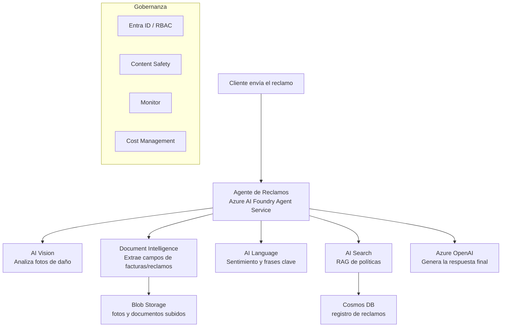

# AI-103 Lab: Damaged-Shipment Claims Agent

A single case study runs through all five phases and the five AI-103 exam domains, with emphasis on the two domains that lowered your score on November 12.

## Case study: Meridian Logistics

Meridian Logistics receives hundreds of weekly claims for damaged packages or missing contents. Today a support agent reviews each case by hand: looks at the damage photos, reads the customer's complaint, transcribes the attached invoice's data, and decides between refund, replacement, or rejection according to the warranty policy.

In this lab you build an agent in Azure AI Foundry that automates those four tasks on the same case and returns a recommendation in minutes. It's the single project that evolves through each phase, the way you prefer to work.

**Case inputs:** a photo of the damaged package, the customer's complaint text, a PDF of the invoice or shipping guide, and a warranty-policy document (PDF or Markdown) with the refund thresholds.

**Expected agent output:** a summary of the claim, the customer's sentiment, the fields extracted from the invoice (order number, amount, date), and a recommendation — refund, replacement, or rejection — justified by citing the policy.

**Test data:** create 15-20 synthetic claims, varying damage severity, customer tone (neutral to very upset), and document quality (clear invoice vs. blurry scan), so each phase has cases to measure accuracy against.

## Solution architecture

**Diagram: an agent orchestrates five AI services over damaged-shipment claims.** The customer sends the claim to the Claims Agent (Foundry Agent Service), which calls four AI services — AI Vision, Document Intelligence, AI Language, AI Search — and Azure OpenAI, then saves the artifacts in Blob Storage and Cosmos DB, all under the same governance layer (Entra ID/RBAC, Content Safety, Monitor, Cost Management). (See the full diagram in the Claude Doc version of this guide.)

The customer sends the claim to the Claims Agent (Foundry Agent Service), which calls the four AI services and saves the artifacts in Blob Storage and Cosmos DB.

## Exam domain coverage

| AI-103 domain | Your most recent result | Lab phase | Where it's practiced |
| --- | --- | --- | --- |
| Plan and manage an Azure AI solution | Needs work | Phase 0 | Provisioning, RBAC, Responsible AI, monitoring, and cost |
| Implement generative AI and agentic solutions | Mastered | Phase 4 | Azure OpenAI, RAG with AI Search, Foundry Agent Service |
| Implement computer vision solutions | Mastered | Phase 1 | Azure AI Vision over the damage photos |
| Implement text analysis solutions | Mastered | Phase 2 | Azure AI Language over the claim text |
| Implement information extraction solutions | Needs work | Phase 3 | Azure AI Document Intelligence over invoices and shipping guides |

The two rows marked "Needs work" are the ones that lowered your score on November 12; spend more time on those phases before the retake.

## Phase 0 — Plan and govern the environment (domain to reinforce)

Goal: provision and secure the Azure resources before writing any code — what the "Plan and manage an Azure AI solution" domain evaluates.

**Resources to create in CarlosSandboxRG:**
1. An Azure AI Foundry resource (hub + project) — the agent's entry point.
2. Azure AI Vision, Language, and Document Intelligence resources (or a multi-service Azure AI Services resource).
3. An Azure OpenAI resource with a chat model deployment (e.g. gpt-4o).
4. An Azure AI Search account for the warranty-policy RAG index. **⏳ Pending — create when starting Phase 4.** Planned: `meridian-search` in eastus, Basic tier with system-assigned managed identity (Free has no managed identity); delete it after the lab to limit cost. Roles to request then: Search Index Data Reader for the Foundry project's managed identity, Search Index Data Contributor for your user, Storage Blob Data Reader on `mylearnaistorage` for the Search identity.
5. A Storage account (Blob container) for photos, PDFs, and the policy.
6. Optional: Cosmos DB, which managed Foundry Agent Service requires for thread history.

**Roles to request via Slack, at resource-group scope:**
- Foundry Owner / Foundry User on the project — you already have these.
- Cognitive Services User on each AI resource — you already have this.
- Search Index Data Contributor and Storage Blob Data Contributor for the Foundry project's managed identity, so the agent can read and write to Search and Storage. You don't have `Microsoft.Authorization/roleAssignments/write`, so an admin assigns these two.

**Governance checklist (what this domain evaluates):**
- [ ] Review the Content Safety filters on the Azure OpenAI deployment and document which categories block content.
- [ ] Turn on Azure Monitor / Application Insights on the Foundry resource and the OpenAI deployment.
- [ ] Set a budget or cost alert on the resource group.
- [ ] Verify every resource sits in a region that supports Foundry Agent Service, to avoid the tenant-mismatch error between portal.azure.com and ai.azure.com.

**Quick quiz:** which role would you assign to a Foundry project's managed identity that only needs to read an AI Search index, not write to it? Answer: Search Index Data Reader, not Contributor — telling read roles from write roles apart is a typical pattern for this domain.

**Acceptance criteria:** you can list, from Azure Portal → IAM, every assigned role and which identity holds it, and explain why each one is needed.

Reference: [Role-based access control for Microsoft Foundry](https://learn.microsoft.com/azure/ai-foundry/concepts/rbac-azure-ai-foundry)

## Phase 1 — Computer vision

Goal: use Azure AI Vision to analyze the damage photos and produce a severity label.

**Steps:**
1. Deploy an Azure AI Vision resource (or use the multi-service one from Phase 0).
2. With the Python SDK, call Image Analysis on each synthetic photo with the `caption`, `tags`, and `objects` features.
3. Write a function that translates the returned tags (e.g. "torn box", "broken glass") into a simple severity: low, medium, or high.
4. Save the result alongside the claim as the case's first structured field.
5. Optional extension: train a Custom Vision classifier on 20-30 of your own photos labeled "damaged" vs. "intact" and compare its accuracy against the tag heuristic.

**Quick quiz:** what's the difference between the Image Analysis endpoint and Custom Vision in terms of when you train your own model? Custom Vision requires your own labeled data; Image Analysis uses a general pretrained model.

**Acceptance criteria:** for each synthetic photo, the agent produces a severity label justified by at least two tags the service returned.

Reference: [Azure AI Vision overview](https://learn.microsoft.com/azure/ai-services/computer-vision/overview)

## Phase 2 — Text analysis

Goal: use Azure AI Language on the complaint text to extract sentiment, key phrases, and PII.

**Steps:**
1. Call Sentiment Analysis on each synthetic claim's text; save the score and the label (positive, neutral, or negative).
2. Call Key Phrase Extraction to get the complaint's main topics (e.g. "crushed box", "urgent refund").
3. Call PII Detection and redact any personal data (name, phone, address) before passing the text to other services or storing it.
4. Combine sentiment and key phrases into a one-line summary the agent will use to prioritize the case: a very upset customer with high damage should be prioritized.

**Quick quiz:** if the customer says "the package arrived fine but the box was dirty," what sentiment and key phrases would you expect, and why shouldn't those alone decide the refund? Sentiment likely comes out neutral or positive despite "dirty box"; key phrases alone don't capture the real severity of the damage, which is why the agent must combine this phase with Vision and Information extraction.

**Acceptance criteria:** every synthetic claim ends up with sentiment, at least 3 key phrases, and zero unredacted PII in the stored text.

Reference: [Azure AI Language overview](https://learn.microsoft.com/azure/ai-services/language-service/overview)

## Phase 3 — Information extraction (domain to reinforce)

Goal: use Azure AI Document Intelligence to extract structured fields from the attached invoice or shipping guide — the domain that hurt your score the most.

**Steps:**
1. First test the prebuilt-invoice model (or prebuilt-receipt) on your synthetic PDFs in Document Intelligence Studio, no code, to see which fields it recognizes natively (order number, amount, date, vendor).
2. Repeat the same call with the Python SDK (`begin_analyze_document`) and compare the returned JSON against what you saw in the Studio.
3. Identify at least 2 Meridian-Logistics-specific fields the prebuilt model does NOT recognize (e.g. "internal route code," "claim number"). These are candidates for a custom model.
4. Train a custom extraction model with 5-10 labeled documents in Document Intelligence Studio, covering at least those 2 fields.
5. Compare the prebuilt model's accuracy vs. the custom one on 3-4 new documents you didn't use for training.
6. Optional: combine the General Document model with a composed model if you have more than one document type (invoice vs. shipping guide) and need to route automatically.

**Quick quiz:** when would you use the Layout model instead of prebuilt-invoice? When the document doesn't have a recognized invoice structure and you only need generic text, tables, and key-value pairs, before deciding whether training a custom model is worth it.

**Acceptance criteria:** you can explain, with real data from your test, why the prebuilt model fell short for at least one field, and show the custom model extracting it correctly.

Reference: [Azure AI Document Intelligence overview](https://learn.microsoft.com/azure/ai-services/document-intelligence/overview)

## Phase 4 — Generative AI and the orchestrator agent

Goal: build the agent in Azure AI Foundry Agent Service that ties together the previous three phases and generates the final response, using RAG over the warranty policy.

**Steps:**
1. Upload the warranty-policy document to Blob Storage and create a vector index in Azure AI Search over it (chunking + embeddings with an Azure OpenAI model, e.g. `text-embedding-3-small`).
2. Create a project and an agent in Azure AI Foundry Agent Service, with clear instructions: "Given a damage summary, sentiment, and invoice data, recommend refund, replacement, or rejection, citing the policy."
3. Pass the outputs of Phases 1-3 as tools or as structured context the agent receives on each thread, not as loose text; practice defining tools with function calling.
4. Connect the Azure AI Search tool as the agent's grounding over the policy index.
5. Explicitly compare the Chat Completions API (manually accumulating message history) against the Responses API (which manages state for you) on the same example conversation; note the difference you observe.
6. Add a Content Safety check before sending the final recommendation to the customer.
7. Evaluate the agent's recommendations with Azure AI Foundry evaluators — groundedness, relevance, and coherence — on your 15-20 synthetic cases; rerun them whenever you change the agent's instructions or prompt to catch regressions.

**Quick quiz:** if the agent needs to run several steps (classify severity, look up policy, draft response) without you defining the exact order in code, what Agent Service pattern are you using? A tool-oriented agent with automatic orchestration, not a fixed prompt chain.

**Acceptance criteria:** the agent processes a complete synthetic case end to end, its recommendation cites at least one sentence from the indexed warranty policy, and its evaluation metrics (groundedness, relevance) stay stable across two prompt changes.

Reference: [Azure AI Foundry Agent Service overview](https://learn.microsoft.com/azure/ai-foundry/agents/overview)

## Phase 5 — End-to-end orchestration and validation

Goal: run the full flow over every synthetic claim and measure how well it covers the exam.

**Steps:**
1. Run the agent over the 15-20 synthetic claims and save, per case: severity (Vision), sentiment and key phrases (Language), extracted fields (Document Intelligence), and final recommendation (OpenAI/Agent).
2. Manually review 5 cases and flag whether the agent's recommendation matches what you would decide; log the disagreements as test cases to refine the agent's instructions.
3. Re-run the "Review before retry" checklist from your Notion plan over Phases 0 and 3, now with this lab's fresh hands-on experience.
4. Use the domain-coverage table above as a quick summary of which Azure resource maps to each exam domain.

**Final acceptance criteria:** you can describe from memory, without looking at the code, which Azure resource solves each of the five exam domains and why, using this same case as the example.

## Resources and test data

- Synthetic dataset: build your 15-20 claims in a notebook or Python script; you don't need real customer data.
- Official documentation used in this lab:
  - [Azure AI Foundry Agent Service](https://learn.microsoft.com/azure/ai-foundry/agents/overview)
  - [Role-based access control for Microsoft Foundry](https://learn.microsoft.com/azure/ai-foundry/concepts/rbac-azure-ai-foundry)
  - [Azure AI Vision](https://learn.microsoft.com/azure/ai-services/computer-vision/overview)
  - [Azure AI Language](https://learn.microsoft.com/azure/ai-services/language-service/overview)
  - [Azure AI Document Intelligence](https://learn.microsoft.com/azure/ai-services/document-intelligence/overview)
- Suggested next step: once all 5 phases are done, schedule the exam retake and re-run the "Review before retry" checklist from your Notion plan.

### Synthetic dataset: 15 sample cases

| ID | Customer complaint | Damage severity | Customer tone | Order # | Amount | Invoice date | Document quality |
| --- | --- | --- | --- | --- | --- | --- | --- |
| C01 | The box arrived crushed and the glass contents broke. | High | Very upset | ORD-10234 | $89.99 | 2026-10-02 | Clear |
| C02 | I noticed a small scratch on the box corner, but the product is fine. | Low | Neutral | ORD-10567 | $45.00 | 2026-10-05 | Clear |
| C03 | A piece of the order was missing and the box arrived partially open. | Medium | Upset | ORD-10789 | $120.50 | 2026-10-08 | Blurry |
| C04 | The packaging was intact but it arrived two days late. | Low | Positive | ORD-11023 | $29.99 | 2026-10-10 | Clear |
| C05 | The TV screen arrived with a broken corner and won't turn on. | High | Very upset | ORD-11245 | $350.00 | 2026-10-11 | Clear |
| C06 | The package smelled damp, like it got wet in transit. | Medium | Upset | ORD-11356 | $75.25 | 2026-10-12 | Blurry |
| C07 | Everything arrived perfect, I just want to confirm the warranty. | None | Neutral | ORD-11489 | $60.00 | 2026-10-13 | Clear |
| C08 | The lamp box arrived crushed on one side and the glass is broken. | High | Very upset | ORD-11590 | $95.00 | 2026-10-14 | Clear |
| C09 | There's a slight dent in the lid, but the product works. | Low | Neutral | ORD-11678 | $55.40 | 2026-10-15 | Blurry |
| C10 | The package arrived without the outer box, just wrapped in a torn plastic bag. | Medium | Upset | ORD-11745 | $40.00 | 2026-10-16 | Clear |
| C11 | The monitor arrived with the screen completely shattered. | High | Very upset | ORD-11890 | $410.00 | 2026-10-18 | Clear |
| C12 | Small impact mark on the packaging, the product looks unaffected. | Low | Positive | ORD-11999 | $33.20 | 2026-10-19 | Clear |
| C13 | Two of the four items in the order were missing. | Medium | Upset | ORD-12045 | $150.00 | 2026-10-20 | Blurry |
| C14 | The chair arrived with a broken leg, can't be assembled. | High | Very upset | ORD-12188 | $210.75 | 2026-10-21 | Clear |
| C15 | The packaging was dirty but the product is in perfect condition. | Low | Neutral | ORD-12299 | $48.60 | 2026-10-22 | Clear |

Generate the damage photo and the invoice/shipping-guide PDF separately for each row (you can make the photos from any edited stock image, and the invoices as a simple PDF with this same data).
